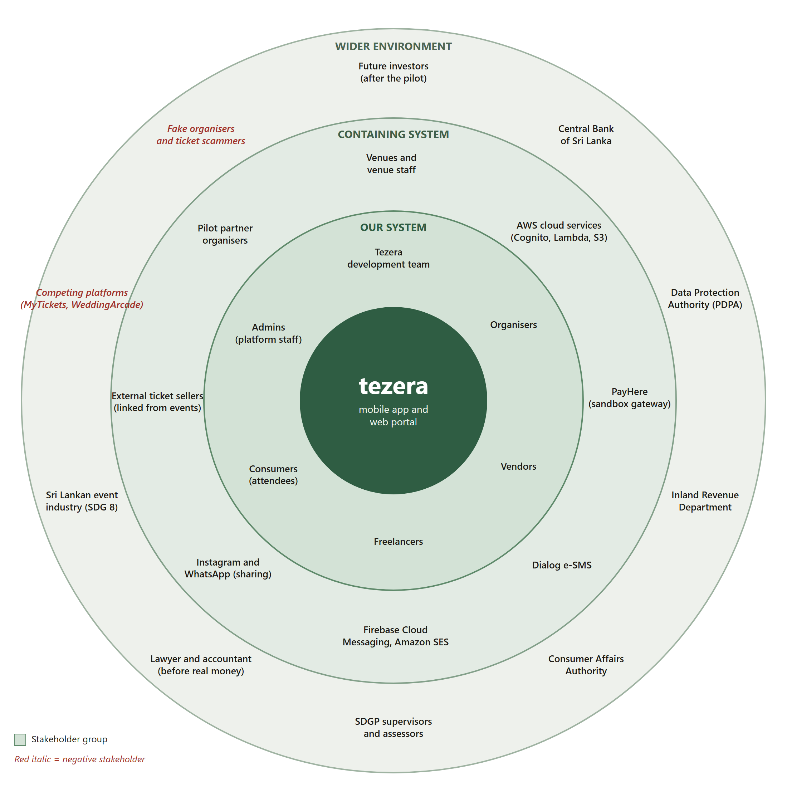
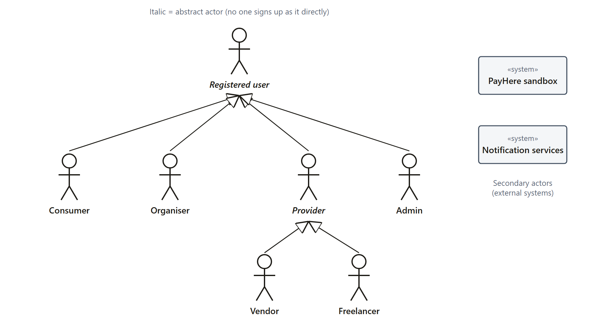
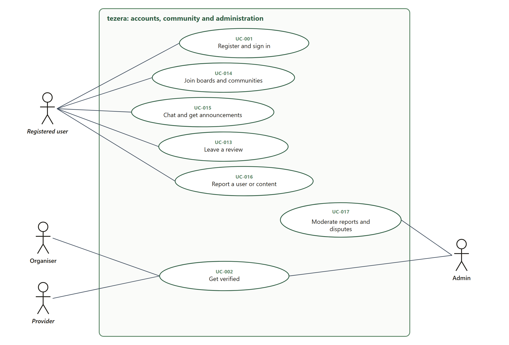
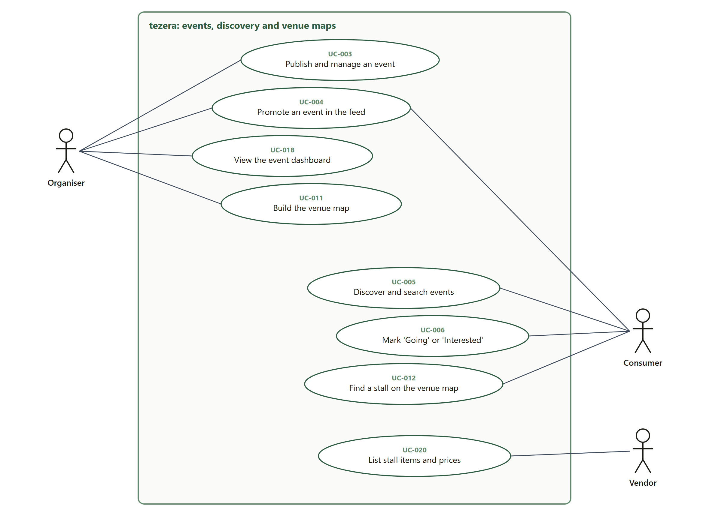
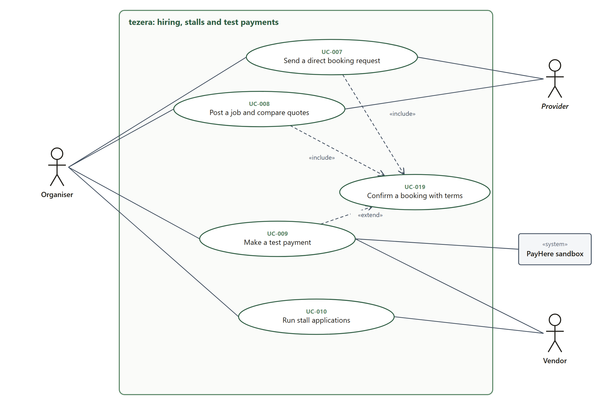

# Chapter 4: System Requirements Specification (SRS)

<!--
About this file
- Draft of Chapter 4 for the SDGP report, written 20 November 2026 from PRD v7, the survey analysis, the research briefs, PRD Research.md and HANDOFF.md.
- Text in [square brackets] is a gap for the team to fill. Tezera has no client. The organiser companies in method 6 are test partners, not clients; their names, dates and findings are not recorded in the repo, so they are [bracket] slots.
- Figures live in report/figures/. To change one, edit report/figures/build-figures.js, run `node report/figures/build-figures.js`, then re-export each PNG, e.g. (Git Bash):
  "/c/Program Files/Google/Chrome/Application/chrome.exe" --headless=new --disable-gpu --hide-scrollbars --force-device-scale-factor=2 --window-size=1180,780 --screenshot="$(cygpath -w "$PWD/report/figures/fig-uc-hiring-stalls-payments.png")" "file:///D:/ATP/report/figures/fig-uc-hiring-stalls-payments.svg"
  (window size = the SVG's width and height).
- Figure and table numbers follow the template (Figure 2, Tables 15 to 19). Renumber them when the chapter goes into the report.
-->

## 4.1 Chapter Overview

This chapter sets out what Tezera must do and how well it must do it. It starts with the people and systems that have a stake in Tezera (4.2), then the methods the team used to find requirements and what each one produced (4.3, 4.4). Use case diagrams and descriptions follow (4.5, 4.6), then the functional and non-functional requirements (4.7, 4.8), and the gaps and assumptions found along the way (4.9).

The requirements cover the ATP release: events and promotion, the hiring marketplace with stalls and reviews, community and chat, and venue maps. Ticketing and QR entry come in the first phase after the ATP, so they are left out here. Every requirement traces back to the PRD (`prd/tezera-prd.html`, version 7), which holds the full detail and the MoSCoW priority of each row.

## 4.2 Stakeholder Analysis

The stakeholders come from the rich picture on page 3 of the project proposal, the PRD's roles (section 3), its dependencies (section 12) and the legal research in the research briefs. Figure 2 places them in the onion model; Table 15 says what each one wants from Tezera.

### 4.2.1 Onion Model

*Figure 2: Onion model of Tezera's stakeholders. Source: `report/figures/fig-onion-model.svg`.*

- **Our system** holds the people who use or run Tezera day to day: the four account types, the admins, and the team that builds and maintains it.
- **Containing system** holds the services Tezera connects to and the groups it works next to: AWS, PayHere, Dialog e-SMS, push and email, Instagram and WhatsApp for sharing, the ticket sellers organisers already use, the venues, and the partner organisers planned for the pilot.
- **Wider environment** holds those who are affected by Tezera or set its rules without using it: regulators, advisers, the event industry, competitors and bad actors.

### 4.2.2 Stakeholder Descriptions

*Table 15: Stakeholder descriptions*

| Role | Stakeholder | Viewpoint |
|---|---|---|
| Functional beneficiary | Organisers (event companies, groups and individuals running large events) | Want one place to promote an event, hire vendors and freelancers they can trust, fill stalls and share the venue layout. All 7 organisers surveyed find providers through personal contacts; 6 named "finding someone suitable" as their main hiring problem. |
| Functional beneficiary | Vendors (F&B stalls, sound and lighting, décor, media agencies) | Want to hear about jobs and open stall slots without relying on contacts, and to see an organiser's payment terms before agreeing. 11 of 13 providers named payment terms as what they most want to know about a new organiser. |
| Functional beneficiary | Freelancers (photographers, videographers, DJs, MCs) | Same needs as vendors, minus stalls. Want a portfolio and reviews that let them compete with agencies on the quality of their work. |
| Functional beneficiary | Consumers (people who attend events) | Want every detail of an event in one place, updates when plans change, a map of the venue, and to see which friends are going. 17 of 26 attendees have missed an event because they heard too late or lacked details. |
| Financial beneficiary | Tezera team (as a future business) | No revenue in the ATP. After it: commission on tickets, then on hiring payments, then premium accounts (PRD section 10). |
| Financial beneficiary | Vendors and freelancers | More paid work through bookings, job posts and stalls; fewer late or missing payments through written terms and instalment tracking. |
| Financial beneficiary | Future investors (after the pilot) | Interested only if the pilot shows organisers and providers use the platform (PRD section 11 metrics). Not approached yet. |
| Social beneficiary | Sri Lankan event industry and local small businesses | Small vendors and freelancers get a visible track record and access to work outside their personal networks (SDG 8, target 8.3; SDG 9, target 9.3). |
| Social beneficiary | Attendees as a community | Event boards, city and topic communities, and friends-going lists help people plan together and meet. 20 of 26 attendees want to know who else is attending. |
| Operational beneficiary | Admins (platform staff) | Need a queue for verification documents, reports and disputes, with the booking or stall history attached, so they can act quickly and fairly. |
| Operational beneficiary | Tezera development team (5 students) | Need a stack the team can build and run with no servers to look after, and a scope that fits the SDGP timeline. |
| Operational beneficiary | Pilot partner organisers (1 or 2, planned) | Run a real event on Tezera with the vendors they already use, and give feedback before the decision point. |
| Negative stakeholder | Fake organisers and ticket scammers | Want to collect stall fees or booking deposits and not deliver. Verification before hiring or stalls (AC-08), admin takedowns (AD-03) and the booking record work against them. Two attendees described scams of this kind. |
| Negative stakeholder | Competing platforms (MyTickets, TicketsMinistry, WeddingArcade, DJBooking.lk and others) | Lose users if Tezera succeeds. None of the 11 platforms checked combines hiring, reputation and community (PRD section 5). |
| Negative stakeholder | Providers who win work on contacts rather than quality (assumed) | Public reviews and rankings may weaken an advantage that rests on personal connections. Not tested in the survey. |
| Regulatory | Central Bank of Sri Lanka | Rules on money or value transfer services. If Tezera collected and paid out money, it would most likely need registration (and LKR 15m capital). This is why payments go straight to each payee's own merchant account and stay in sandbox during the ATP. |
| Regulatory | Data Protection Authority (Personal Data Protection Act, No. 9 of 2022) | Processing rules and controller duties start on 1 January 2027 (two secondary reports; gazette not opened). Tezera holds NIC scans, phone numbers and messages, so it must collect the minimum, allow access and deletion, and report a breach within 72 hours. |
| Regulatory | Inland Revenue Department | 5% withholding tax on freelancer fees over LKR 100,000 a month, VAT and SSCL thresholds. Matters only when real money moves. |
| Regulatory | Consumer Affairs Authority | E-commerce rules may apply to bookings, especially with individual organisers. Not checked with a lawyer. |
| Experts | SDGP supervisors and assessors | Judge whether the requirements are complete, traced and testable, and whether the ATP release meets the module's criteria. |
| Experts | Lawyer and accountant (before real money) | Answer the "Before taking real money" questions in PRD section 14. Not engaged yet. |
| Neighbouring systems | AWS cloud services (Cognito, Lambda, API Gateway, DynamoDB, S3, CloudFront, SQS, SES, Amplify Hosting) | Host the API, web portal, sign-in, files and queues in ap-south-1 (Mumbai). Costs follow use; free allowances apply. |
| Neighbouring systems | Hosted PostgreSQL service (provider not chosen) | Main database for accounts, events, bookings, reviews and maps. Suggested: a hosted service with a connection pooler for `dev`, Amazon RDS later. |
| Neighbouring systems | PayHere (sandbox) | Takes test payments on each payee's own merchant account and calls Tezera back with the result. |
| Neighbouring systems | Dialog e-SMS, Firebase Cloud Messaging, Amazon SES | Send sign-up codes and urgent alerts by SMS, push notifications to the app, and email. |
| Neighbouring systems | Instagram and WhatsApp | Where attendees find events (25 of 26) and make plans (14 of 26). Tezera does not replace them; event links must preview well there. |
| Neighbouring systems | External ticket sellers | Organisers keep selling tickets there during the ATP; event pages link to them. |
| Neighbouring systems | Venues and venue staff | Supply floor plans; staff and signs still guide people on the day. |

## 4.3 Selection of Requirement Elicitation Techniques / Methods

Tezera is the team's own product idea, so it has no external client. The team wrote its own project brief on 30 September 2026 (`PRD Research.md`, section 2.1). Requirements then came from the people who will use Tezera: a questionnaire for each of the three user groups, and conversations with organiser companies that have agreed to test Tezera before the pilot. These companies are not clients; they speak for organisers as users.

| # | Technique | Used with | Why it was chosen | Status |
|---|---|---|---|---|
| 1 | Project brief and structured question rounds | The team (brief author: Navindu Ranwatte) | Turned a one-paragraph idea into decisions on roles, hiring, reviews, maps and money. Six rounds of multiple-choice questions, each with the reason for every option. | Done, 30 September 2026 |
| 2 | Desk research | Competitor websites, Sri Lankan law, payment gateways | Checked whether a platform like Tezera already exists, and what the law allows before any feature touches personal data or money. | Done: competitors and PDPA on 30 September 2026; payments law and gateways on 15 October 2026 |
| 3 | Questionnaires | 26 attendees, 7 organisers, 13 vendors and freelancers (46 responses from 39 people) | Reached all three user groups in five days. Mixed multiple-choice questions with open questions about recent problems. | Done, 4 to 8 October 2026 (Google Forms) |
| 4 | Team review sessions | The five team members | Each finding was turned into a proposed PRD change and decided by the group, with the date and decider recorded in `HANDOFF.md`. | Done: 6, 8 and 15 October; 20 November 2026 |
| 5 | Prototyping | The team; not yet shown to users | Made the requirements concrete enough to spot gaps: a clickable vendor web portal wireframe (18 pages), organiser and vendor mind maps, and a working sign-in slice in code. | Done: 19 to 22 October and 19 November 2026 |
| 6 | Conversations with organiser companies | [Number] organiser companies that will test Tezera before the pilot: [company names, or "names withheld"; who the team spoke to and their role] | People who run events for a living can say what the hiring, stall and map features must do, and check the survey results. They will also test the product before the pilot. | Done, [dates]. [Format: in person, call or online] |
| 7 | Semi-structured interviews | 2 or 3 of the surveyed organisers | Seven survey answers cannot show how organisers would use the hiring flow. | Planned (survey analysis, section 9) |
| 8 | Prototype tests | 5 or 6 providers; attendees | Show providers a mock booking request with a structured brief and payment terms; test the interactive map with attendees; time the three PRD tasks (publish an event, post a job, upload a venue map). | Planned |

Observation at live events has not been used so far.

## 4.4 Discussion / Analysis of Results

### Project brief and question rounds

The brief asked for "a central hub" where organisers hire vendors, promote events, share a venue map and talk to consumers, with "a forum style for people to communicate and meet up", rankings and review pages. The question rounds settled what the brief left open: a mobile app plus a web portal; vendors are businesses and freelancers are individuals; organisers hire by direct booking or by job post; stalls fill by invitation or application; reviews run in four directions; one role per account; only organisers post to the feed. These answers are the source of most functional requirements in Table 17 (source code PB).

*Validation:* each answer was written into PRD version 1 and checked by the brief's author. The answers were later tested against the surveys (method 3) [and the organiser conversations, method 6].

### Desk research

Of 11 platforms checked (5 Sri Lankan ticketing sites, 4 Sri Lankan vendor directories, and Eventeny, Posh, Eventbrite and Meetup abroad), none combines ticketing, vendor and freelancer hiring, and community. Eventeny comes closest, with vendors and maps but no freelancers or community. Local ticket sites already offer QR entry and seat selection, so those are table stakes. This is one reason the group moved ticketing out of the ATP on 6 October 2026: hiring, reputation and community are what set Tezera apart.

The payments research (15 October 2026) found that a platform that collects money and pays it on would most likely need Central Bank registration as a money or value transfer service. The group therefore chose sandbox-only payments in the ATP, with money going straight to each payee's own PayHere merchant account (FR31 to FR34). The PDPA research set the privacy requirements (NFR9).

*Validation:* sources are listed in the PRD and the research briefs, each marked opened or found through search. The legal findings come from a research agent and are not legal advice; a lawyer has not checked them.

### Questionnaires

The surveys backed seven of the nine problems the PRD had assumed, partly backed two, and left one untested (freelancers versus agencies). The main results:

- **Attendees** find events on Instagram (25 of 26) and through friends (22). 17 have missed an event through late or scattered information. 24 trust information only from the official organiser account. 18 have struggled to find something at a venue, most often toilets, entrances, parking and seating.
- **Organisers** all find providers through personal contacts and past vendors. Their biggest problems are finding someone suitable (6 of 7) and work that falls short (5). Only 1 of 7 shares a digital venue map. One described paying vendors in many small instalments that are hard to track.
- **Vendors and freelancers** name last-minute cancellations (9 of 13) and late or missing payment (7) as their biggest problems. 11 want an organiser's payment terms before taking a job. Briefs usually lack deliverables, run-of-show timings and audience details.

From these the team proposed 12 changes (R1 to R12). All 12 were accepted on 15 October 2026 and are in the PRD: structured briefs (R1), payment and cancellation terms on bookings (R2), payment tracking (R3), late cancellations on the record (R4), "Know before you go" (R5), live event status (R6), more map pins (R7), an offline map (R8), sharing to Instagram and WhatsApp (R9), review tags and replies (R10), a facilities rating (R11), and age ratings with a minimum account age (R12).

*Validation:* each survey result was checked against the PRD's own hypotheses (survey analysis, section 2), and each change went to a group decision. The limits are stated in the analysis: small samples from the team's own networks, mostly Colombo and mostly students, and some people answered more than one survey. Treat percentages as signals. Follow-up interviews and prototype tests (methods 7 and 8) are planned to test R1 to R4 and the map.

### Team review sessions

The group sessions turned research into decisions: ticketing out of the ATP and 'Going' marks to unlock attendee reviews (6 October); the name Tezera (8 October); all twelve survey changes, the interactive 2D map in place of a 3D view, the map builder and sandbox payments (15 October); and the stack (20 November). Each decision, its date and who made it is in `HANDOFF.md`.

*Validation:* PRD changes carry a version tag (v2 to v7) and a "What changed" box, so the team can see what moved. Several decisions were made by one member and still need the whole group to confirm them (listed in `HANDOFF.md`, "Needs the group's review").

### Prototyping

The vendor web portal wireframe (22 October 2026) covers the vendor's dashboard, requests, jobs, stalls, bookings, payments, profile, reviews and verification. The organiser and vendor mind maps (19 and 20 October) map every PRD row for those roles onto screens. Building them exposed two gaps: no PRD row described the list of open stall slots a vendor browses (taken from user story US-P13), and the mind maps needed a "Forgot password" and "Log out" that are not PRD rows. The sign-in slice (19 November) proved Cognito sign-in, the NestJS token check and the first database table work end to end.

*Validation:* none of the prototypes has been shown to users yet. [Add results after the prototype tests.]

### Conversations with organiser companies

The team spoke with [number] organiser companies, [names or "names withheld"], on [dates]. They are not clients. They run events in Sri Lanka and have agreed to test Tezera before the pilot.

[Record for each conversation: who the team spoke to and their role, what was shown or asked, and what they said. Then list which requirements they confirmed, changed or added, with the PRD rows or FR numbers affected.]

*Validation:* [How the findings were checked, for example against the organiser survey answers, and which changes went to a group decision and reached the PRD.]

## 4.5 Use Case Diagram

The use cases are split into three diagrams by module, so each stays readable. Figure 3 shows the actors first. A registered user is any signed-in person; providers are vendors and freelancers together. Use case IDs run from UC-001 to UC-020 across all three diagrams.

*Figure 3: Actors and how they relate.*

*Figure 4: Use cases for accounts, community and administration.*

*Figure 5: Use cases for events, discovery and venue maps.*

*Figure 6: Use cases for hiring, stalls and test payments. Both hiring routes include confirming a booking with its terms; a test payment extends a confirmed booking.*

| ID | Use case | Primary actor | PRD rows |
|---|---|---|---|
| UC-001 | Register and sign in | Registered user | AC-01 |
| UC-002 | Get verified | Organiser, provider | AC-08, AC-09, AD-01 |
| UC-003 | Publish and manage an event | Organiser | EV-01, EV-02, EV-08 to EV-10 |
| UC-004 | Promote an event in the feed | Organiser | EV-03, EV-04 |
| UC-005 | Discover and search events | Consumer | EV-05, EV-07 |
| UC-006 | Mark an event 'Going' or 'Interested' | Consumer | EV-06, CM-06 |
| UC-007 | Send a direct booking request | Organiser | HR-01 to HR-04 |
| UC-008 | Post a job and compare quotes | Organiser | HR-05 to HR-07 |
| UC-009 | Make a test payment | Organiser, vendor | HR-14, HR-17 to HR-20 |
| UC-010 | Run stall applications | Organiser | HR-10 to HR-13, HR-18 |
| UC-011 | Build the venue map | Organiser | VM-01 to VM-03, VM-08, VM-16 to VM-22 |
| UC-012 | Find a stall on the venue map | Consumer | VM-04, VM-09, VM-11 to VM-15 |
| UC-013 | Leave a review | Registered user | RV-01 to RV-03, RV-08 to RV-10 |
| UC-014 | Join boards and communities | Registered user | CM-01 to CM-05 |
| UC-015 | Chat and get announcements | Registered user | MS-01 to MS-08 |
| UC-016 | Report a user or content | Registered user | AC-07 |
| UC-017 | Moderate reports and disputes | Admin | AD-02 to AD-06, RV-07 |
| UC-018 | View the event dashboard | Organiser | OD-01, OD-03, OD-04 |
| UC-019 | Confirm a booking with terms | Organiser, provider | HR-08, HR-09, HR-15, HR-16 |
| UC-020 | List stall items and prices | Vendor | VM-10 |

## 4.6 Use Case Descriptions

The ten use cases below carry the main flows of the ATP release. The others follow the same pattern and are covered by the user stories in Section 6.4.2.

*Table 16.1: UC-001 Register and sign in*

<table>
<tr><th>Use Case Name</th><td colspan="2">Register and sign in</td></tr>
<tr><th>Use Case ID</th><td colspan="2">UC-001</td></tr>
<tr><th>Description</th><td colspan="2">A person creates a Tezera account with one role, verifies their email address or phone number, and signs in on the app or the web portal.</td></tr>
<tr><th>Priority</th><td colspan="2">Must</td></tr>
<tr><th>Primary Actor</th><td colspan="2">Registered user (consumer, organiser, vendor or freelancer)</td></tr>
<tr><th>Supporting Actors</th><td colspan="2">Notification services (Dialog e-SMS for phone codes, Amazon SES for email codes)</td></tr>
<tr><th>Pre-Conditions</th><td colspan="2">The person has no account for this email address or phone number. The device is online.</td></tr>
<tr><th>Trigger</th><td colspan="2">The person taps "Sign up".</td></tr>
<tr><th rowspan="4">Main flow</th><th>Actors</th><th>System</th></tr>
<tr><td>1. Enters an email address or phone number, a password and a date of birth, and picks one role.</td><td>2. Checks the person is 16 or over (proposed). For under-18s, asks them to confirm a parent or guardian agreed.</td></tr>
<tr><td>3. Ticks the guardian box, if asked, and submits.</td><td>4. Creates the account in Amazon Cognito, adds it to the group for that role, and sends a one-time code.</td></tr>
<tr><td>5. Enters the code.</td><td>6. Confirms the account, signs the person in, creates their user record on the first API call, and opens the home screen for their role.</td></tr>
<tr><th rowspan="4">Exception flow</th><th>Actors</th><th>System</th></tr>
<tr><td>E1. Enters a date of birth under 16.</td><td>Refuses the sign-up and says the minimum age is 16.</td></tr>
<tr><td>E2. Enters a wrong or expired code.</td><td>Shows an error and offers to send a new code.</td></tr>
<tr><td>E3. Uses an email address or phone number that already has an account.</td><td>Says an account exists and offers "Sign in" and "Forgot password".</td></tr>
<tr><th rowspan="3">Alternate flow</th><th>Actors</th><th>System</th></tr>
<tr><td>A1. An existing user enters their email address or phone number and password.</td><td>Checks them with Cognito and opens the home screen for the user's role.</td></tr>
<tr><td>A2. Taps "Forgot password" and enters the code sent to them and a new password.</td><td>Resets the password and signs the user in.</td></tr>
<tr><th>Exclusions</th><td colspan="2">One account holding more than one role. Sign-in with Google or Apple (not in the PRD).</td></tr>
<tr><th>Post-Conditions</th><td colspan="2">A verified account exists in exactly one role group, with a matching user record in the database.</td></tr>
</table>

*Table 16.2: UC-002 Get verified*

<table>
<tr><th>Use Case Name</th><td colspan="2">Get verified</td></tr>
<tr><th>Use Case ID</th><td colspan="2">UC-002</td></tr>
<tr><th>Description</th><td colspan="2">An organiser or provider uploads verification documents; an admin checks them and approves or rejects the account.</td></tr>
<tr><th>Priority</th><td colspan="2">Must</td></tr>
<tr><th>Primary Actor</th><td colspan="2">Organiser or provider</td></tr>
<tr><th>Supporting Actors</th><td colspan="2">Admin; notification services</td></tr>
<tr><th>Pre-Conditions</th><td colspan="2">The user is signed in as an organiser, vendor or freelancer and is not yet verified.</td></tr>
<tr><th>Trigger</th><td colspan="2">The user opens "Get verified", or tries an action that needs verification (UC-007, UC-008, UC-010).</td></tr>
<tr><th rowspan="4">Main flow</th><th>Actors</th><th>System</th></tr>
<tr><td>1. Uploads the documents asked for (proposed: business registration for companies, NIC for individuals).</td><td>2. Stores them in a private location only admins can read, and adds the request to the admin queue.</td></tr>
<tr><td>3. Admin opens the request and views the documents.</td><td>4. Shows each document through a short-lived signed link.</td></tr>
<tr><td>5. Admin approves.</td><td>6. Marks the account verified, shows the Verified badge, unlocks hiring, stalls and bookings, logs the decision and notifies the user.</td></tr>
<tr><th rowspan="3">Exception flow</th><th>Actors</th><th>System</th></tr>
<tr><td>E1. Uploads a file that is too large or of the wrong type.</td><td>Rejects the file and says why.</td></tr>
<tr><td>E2. Admin rejects the request and gives a reason.</td><td>Notifies the user with the reason; the user can upload new documents.</td></tr>
<tr><th rowspan="2">Alternate flow</th><th>Actors</th><th>System</th></tr>
<tr><td>A1. An unverified organiser tries to post a job.</td><td>Blocks the action and opens "Get verified".</td></tr>
<tr><th>Exclusions</th><td colspan="2">Automatic checks against government records. Verification of consumers.</td></tr>
<tr><th>Post-Conditions</th><td colspan="2">The account is verified or rejected, with the admin's name, time and reason in the audit log.</td></tr>
</table>

*Table 16.3: UC-003 Publish and manage an event*

<table>
<tr><th>Use Case Name</th><td colspan="2">Publish and manage an event</td></tr>
<tr><th>Use Case ID</th><td colspan="2">UC-003</td></tr>
<tr><th>Description</th><td colspan="2">An organiser creates an event page, publishes it, and keeps it up to date, including its live status on the day.</td></tr>
<tr><th>Priority</th><td colspan="2">Must (live status, "Know before you go" and age rating: Should)</td></tr>
<tr><th>Primary Actor</th><td colspan="2">Organiser</td></tr>
<tr><th>Supporting Actors</th><td colspan="2">Consumer (receives updates); notification services</td></tr>
<tr><th>Pre-Conditions</th><td colspan="2">The organiser is signed in.</td></tr>
<tr><th>Trigger</th><td colspan="2">The organiser taps "New event".</td></tr>
<tr><th rowspan="4">Main flow</th><th>Actors</th><th>System</th></tr>
<tr><td>1. Enters title, category, date and time, venue, description, cover image, line-up, entry price or "free", age rating, and optional "Know before you go" fields and a ticket link.</td><td>2. Validates the required fields and saves a draft.</td></tr>
<tr><td>3. Taps "Publish".</td><td>4. Publishes the page, creates its discussion board and Q&amp;A, and makes it searchable.</td></tr>
<tr><td>5. Later changes the date, time or venue.</td><td>6. Saves the change and notifies everyone who marked the event 'Going' or 'Interested'.</td></tr>
<tr><th rowspan="3">Exception flow</th><th>Actors</th><th>System</th></tr>
<tr><td>E1. Leaves a required field empty or sets a date in the past.</td><td>Keeps the draft and highlights the field.</td></tr>
<tr><td>E2. Cancels the event.</td><td>Asks for confirmation, marks it cancelled, closes its stall applications and job posts, and notifies 'Going' and 'Interested' consumers by push, and urgently by SMS.</td></tr>
<tr><th rowspan="2">Alternate flow</th><th>Actors</th><th>System</th></tr>
<tr><td>A1. On the day, sets the status to "Running late" with a new start time.</td><td>Shows the status on the event page and pushes it to 'Going' and 'Interested' consumers.</td></tr>
<tr><th>Exclusions</th><td colspan="2">Selling tickets and QR entry (after the ATP). Checking attendees' ages (organisers check ID at the gate).</td></tr>
<tr><th>Post-Conditions</th><td colspan="2">The event is published (or saved as a draft) and every change is visible to consumers.</td></tr>
</table>

*Table 16.4: UC-007 Send a direct booking request*

<table>
<tr><th>Use Case Name</th><td colspan="2">Send a direct booking request</td></tr>
<tr><th>Use Case ID</th><td colspan="2">UC-007</td></tr>
<tr><th>Description</th><td colspan="2">An organiser finds a provider and sends a booking request with a brief, budget and terms; the provider accepts, declines or quotes.</td></tr>
<tr><th>Priority</th><td colspan="2">Must</td></tr>
<tr><th>Primary Actor</th><td colspan="2">Organiser</td></tr>
<tr><th>Supporting Actors</th><td colspan="2">Provider (vendor or freelancer); notification services</td></tr>
<tr><th>Pre-Conditions</th><td colspan="2">The organiser is verified and has a published or draft event. The provider is verified.</td></tr>
<tr><th>Trigger</th><td colspan="2">The organiser taps "Request booking" on a provider's profile.</td></tr>
<tr><th rowspan="5">Main flow</th><th>Actors</th><th>System</th></tr>
<tr><td>1. Searches providers by category, district, rating, rank, verified status and available date, and opens a profile.</td><td>2. Shows results ordered by rank score, and the profile with portfolio and reviews.</td></tr>
<tr><td>3. Picks the event, date, times and budget; fills any of the brief fields (service, duration, audience, deliverables, run-of-show, equipment); sets payment and cancellation terms.</td><td>4. Sends the request to the provider and notifies them.</td></tr>
<tr><td>5. Provider reads the brief and terms and taps "Accept".</td><td>6. Runs UC-019: creates the confirmed booking with the agreed service, date, price and terms, and notifies the organiser.</td></tr>
<tr><td>7. After the event, the organiser marks the booking completed.</td><td>8. Opens reviews for both sides (UC-013).</td></tr>
<tr><th rowspan="3">Exception flow</th><th>Actors</th><th>System</th></tr>
<tr><td>E1. Provider declines.</td><td>Notifies the organiser and suggests other providers from the same search.</td></tr>
<tr><td>E2. Either side cancels a confirmed booking within 7 days of the event (proposed).</td><td>Records the late cancellation on the canceller's profile. If the provider cancelled, offers the organiser a job post prefilled from the booking.</td></tr>
<tr><th rowspan="2">Alternate flow</th><th>Actors</th><th>System</th></tr>
<tr><td>A1. Provider replies with a different quote and terms.</td><td>Sends the quote to the organiser; the booking is created only if the organiser accepts it.</td></tr>
<tr><th>Exclusions</th><td colspan="2">Hiring for private events with no public event page (open question). Contracts with legal force.</td></tr>
<tr><th>Post-Conditions</th><td colspan="2">A confirmed booking exists with its brief, price and terms on record, or the request is closed as declined.</td></tr>
</table>

*Table 16.5: UC-008 Post a job and compare quotes*

<table>
<tr><th>Use Case Name</th><td colspan="2">Post a job and compare quotes</td></tr>
<tr><th>Use Case ID</th><td colspan="2">UC-008</td></tr>
<tr><th>Description</th><td colspan="2">An organiser posts a job; matching providers apply with quotes; the organiser compares them and accepts one or more.</td></tr>
<tr><th>Priority</th><td colspan="2">Must</td></tr>
<tr><th>Primary Actor</th><td colspan="2">Organiser</td></tr>
<tr><th>Supporting Actors</th><td colspan="2">Providers; notification services</td></tr>
<tr><th>Pre-Conditions</th><td colspan="2">The organiser is verified and has an event.</td></tr>
<tr><th>Trigger</th><td colspan="2">The organiser taps "Post a job".</td></tr>
<tr><th rowspan="4">Main flow</th><th>Actors</th><th>System</th></tr>
<tr><td>1. Enters the job (for example "2 photographers, 12 Dec, Colombo"), requirements, brief fields, budget range and quote deadline.</td><td>2. Publishes the job to providers whose category and district match.</td></tr>
<tr><td>3. Providers apply with a quote, a message and any terms of their own.</td><td>4. Lists the quotes side by side with each provider's rating, rank and verified status.</td></tr>
<tr><td>5. Organiser accepts one or more quotes.</td><td>6. Runs UC-019 for each accepted quote and tells the other applicants the job is filled when it closes.</td></tr>
<tr><th rowspan="2">Exception flow</th><th>Actors</th><th>System</th></tr>
<tr><td>E1. The deadline passes with no quotes.</td><td>Notifies the organiser and offers to extend the deadline or widen the district.</td></tr>
<tr><th rowspan="2">Alternate flow</th><th>Actors</th><th>System</th></tr>
<tr><td>A1. Organiser messages a provider about their quote before deciding.</td><td>Opens a 1:1 chat linked to the job post.</td></tr>
<tr><th>Exclusions</th><td colspan="2">Automatic matching or bidding. Unverified providers applying.</td></tr>
<tr><th>Post-Conditions</th><td colspan="2">Each accepted quote is a confirmed booking; the job is closed or stays open for the remaining places.</td></tr>
</table>

*Table 16.6: UC-009 Make a test payment*

<table>
<tr><th>Use Case Name</th><td colspan="2">Make a test payment</td></tr>
<tr><th>Use Case ID</th><td colspan="2">UC-009</td></tr>
<tr><th>Description</th><td colspan="2">An organiser pays a deposit or instalment on a booking, or a vendor pays a stall fee, through the payee's own PayHere merchant account in sandbox mode. No real money moves.</td></tr>
<tr><th>Priority</th><td colspan="2">Should</td></tr>
<tr><th>Primary Actor</th><td colspan="2">Organiser (instalments) or vendor (stall fees)</td></tr>
<tr><th>Supporting Actors</th><td colspan="2">PayHere sandbox; the payee (provider or organiser)</td></tr>
<tr><th>Pre-Conditions</th><td colspan="2">A confirmed booking with payment terms, or an approved stall with a fee. The payee has connected a PayHere sandbox merchant account.</td></tr>
<tr><th>Trigger</th><td colspan="2">The payer taps "Pay" on an instalment or stall fee.</td></tr>
<tr><th rowspan="4">Main flow</th><th>Actors</th><th>System</th></tr>
<tr><td>1. Taps "Pay" and confirms the amount.</td><td>2. Records a pending payment and opens the payee's PayHere checkout (hosted page on the web, PayHere SDK in the app), labelled "Test payment, no real money".</td></tr>
<tr><td>3. Pays with a PayHere test card.</td><td>4. PayHere calls Tezera's notify route. The system checks the signature, updates the payment once per order ID, and marks the instalment received or the stall paid.</td></tr>
<tr><td></td><td>5. Sends both sides a receipt that shows Tezera's commission as a separate line, not charged.</td></tr>
<tr><th rowspan="3">Exception flow</th><th>Actors</th><th>System</th></tr>
<tr><td>E1. The payment fails or is cancelled at checkout.</td><td>Keeps the instalment due and tells the payer.</td></tr>
<tr><td>E2. A notice arrives with a bad signature, or a second time.</td><td>Ignores it and logs it; the payment does not change.</td></tr>
<tr><th rowspan="2">Alternate flow</th><th>Actors</th><th>System</th></tr>
<tr><td>A1. The payee has no connected account.</td><td>Hides "Pay"; the payer pays outside the app and the payee marks the instalment received (payment tracking, HR-15).</td></tr>
<tr><th>Exclusions</th><td colspan="2">Real money. Tezera collecting, holding or splitting funds. Ticket payments and refunds.</td></tr>
<tr><th>Post-Conditions</th><td colspan="2">The payment record, instalment or stall status, and both receipts are stored and visible to admins in disputes.</td></tr>
</table>

*Table 16.7: UC-010 Run stall applications*

<table>
<tr><th>Use Case Name</th><td colspan="2">Run stall applications</td></tr>
<tr><th>Use Case ID</th><td colspan="2">UC-010</td></tr>
<tr><th>Description</th><td colspan="2">An organiser opens stall slots for an event; vendors apply or are invited; the organiser approves vendors and gives each a stall number.</td></tr>
<tr><th>Priority</th><td colspan="2">Must</td></tr>
<tr><th>Primary Actor</th><td colspan="2">Organiser</td></tr>
<tr><th>Supporting Actors</th><td colspan="2">Vendor; notification services</td></tr>
<tr><th>Pre-Conditions</th><td colspan="2">The organiser is verified and the event exists.</td></tr>
<tr><th>Trigger</th><td colspan="2">The organiser taps "Open stalls" on the event.</td></tr>
<tr><th rowspan="4">Main flow</th><th>Actors</th><th>System</th></tr>
<tr><td>1. Sets stall types, number of slots, fee in LKR and application deadline.</td><td>2. Lists the open slots for vendors to browse.</td></tr>
<tr><td>3. Vendor applies for a slot.</td><td>4. Adds the application to the organiser's list and notifies the organiser.</td></tr>
<tr><td>5. Organiser approves the vendor and gives a stall number.</td><td>6. Confirms the stall, shows the fee, notifies the vendor, and lists the vendor and stall number on the event page.</td></tr>
<tr><th rowspan="2">Exception flow</th><th>Actors</th><th>System</th></tr>
<tr><td>E1. Organiser rejects an application.</td><td>Notifies the vendor; the slot stays open.</td></tr>
<tr><th rowspan="2">Alternate flow</th><th>Actors</th><th>System</th></tr>
<tr><td>A1. Organiser invites a vendor directly; the vendor accepts.</td><td>Treats acceptance as approval and continues at step 5.</td></tr>
<tr><th>Exclusions</th><td colspan="2">Freelancers taking stalls. Real-money stall fees (the fee is paid outside the app, or as a test payment in UC-009).</td></tr>
<tr><th>Post-Conditions</th><td colspan="2">Each approved vendor has a confirmed stall with a number, ready to place on the venue map and list items (UC-020).</td></tr>
</table>

*Table 16.8: UC-011 Build the venue map*

<table>
<tr><th>Use Case Name</th><td colspan="2">Build the venue map</td></tr>
<tr><th>Use Case ID</th><td colspan="2">UC-011</td></tr>
<tr><th>Description</th><td colspan="2">An organiser builds the event's venue map in the web map builder: zones, stalls and pins over a floor plan or grid, to scale, then publishes it.</td></tr>
<tr><th>Priority</th><td colspan="2">Must (PDF, blank grid and saved venue maps: Should; AI first draft: Could)</td></tr>
<tr><th>Primary Actor</th><td colspan="2">Organiser</td></tr>
<tr><th>Supporting Actors</th><td colspan="2">Amazon Bedrock (AI first draft, Could)</td></tr>
<tr><th>Pre-Conditions</th><td colspan="2">The organiser is signed in on the web portal and the event exists.</td></tr>
<tr><th>Trigger</th><td colspan="2">The organiser opens "Venue map" on the event.</td></tr>
<tr><th rowspan="5">Main flow</th><th>Actors</th><th>System</th></tr>
<tr><td>1. Uploads a floor plan image (PNG or JPG).</td><td>2. Sets it as the background layer.</td></tr>
<tr><td>3. Marks two points on the plan and enters the real distance between them.</td><td>4. Sets the scale so sizes show in metres.</td></tr>
<tr><td>5. Draws zones, places stalls and pins (stage, entrance, toilet, parking, first aid and others), snaps them to the grid, numbers a row of stalls in one step, and assigns approved vendors to stalls.</td><td>6. Saves each item with a stable ID and position in 0 to 1 coordinates, in the standard map format.</td></tr>
<tr><td>7. Taps "Publish".</td><td>8. Saves a new version, keeps the old ones, and sends the new map to everyone viewing it.</td></tr>
<tr><th rowspan="3">Exception flow</th><th>Actors</th><th>System</th></tr>
<tr><td>E1. Two organisers edit the same item at once.</td><td>Refuses the later save and shows the newer version (stale-edit check).</td></tr>
<tr><td>E2. Uploads a file that is not an image or PDF, or is too large.</td><td>Rejects it and says why.</td></tr>
<tr><th rowspan="4">Alternate flow</th><th>Actors</th><th>System</th></tr>
<tr><td>A1. Uploads a PDF floor plan instead.</td><td>Turns its first page into the background image.</td></tr>
<tr><td>A2. Starts from a blank grid (for example 60 m × 40 m) or a saved venue map.</td><td>Creates the map from it; stall assignments are not copied.</td></tr>
<tr><td>A3. Asks for an AI first draft.</td><td>Sends the floor plan to Claude on Amazon Bedrock and opens the suggested zones, stalls and pins as an editable draft. Nothing is published until the organiser checks it and publishes.</td></tr>
<tr><th>Exclusions</th><td colspan="2">3D views. Google Maps directions to the venue (open question). Full editing on mobile (quick edits only).</td></tr>
<tr><th>Post-Conditions</th><td colspan="2">A published, versioned map is linked to the event and visible to consumers (UC-012).</td></tr>
</table>

*Table 16.9: UC-012 Find a stall on the venue map*

<table>
<tr><th>Use Case Name</th><td colspan="2">Find a stall on the venue map</td></tr>
<tr><th>Use Case ID</th><td colspan="2">UC-012</td></tr>
<tr><th>Description</th><td colspan="2">A consumer opens an event's venue map, finds a stall by zone or by what it sells, and sees its items and prices.</td></tr>
<tr><th>Priority</th><td colspan="2">Must (stage line-ups and stall-type filter: Should; offline map: Could)</td></tr>
<tr><th>Primary Actor</th><td colspan="2">Consumer</td></tr>
<tr><th>Supporting Actors</th><td colspan="2">None</td></tr>
<tr><th>Pre-Conditions</th><td colspan="2">The event has a published map.</td></tr>
<tr><th>Trigger</th><td colspan="2">The consumer taps "Venue map" on the event page.</td></tr>
<tr><th rowspan="4">Main flow</th><th>Actors</th><th>System</th></tr>
<tr><td>1. Opens the map, zooms and pans.</td><td>2. Draws the layout, zones, stalls and pins at a size suited to the screen.</td></tr>
<tr><td>3. Searches for an item, for example "kottu".</td><td>4. Highlights every stall that lists it.</td></tr>
<tr><td>5. Taps a highlighted stall.</td><td>6. Shows the vendor's name and photo, stall number, description, items and prices in LKR, and a link to the vendor's profile.</td></tr>
<tr><th rowspan="2">Exception flow</th><th>Actors</th><th>System</th></tr>
<tr><td>E1. No stall sells the item.</td><td>Says so and keeps the map as it was.</td></tr>
<tr><th rowspan="4">Alternate flow</th><th>Actors</th><th>System</th></tr>
<tr><td>A1. Taps "Find on map" beside a vendor in the event's vendor list.</td><td>Opens the map centred on that stall.</td></tr>
<tr><td>A2. Uses a screen reader.</td><td>Offers every zone, stall and pin as a list.</td></tr>
<tr><td>A3. Loses signal at the venue (mobile app).</td><td>Shows the saved map, times and announcements with a "last updated" time.</td></tr>
<tr><th>Exclusions</th><td colspan="2">Turn-by-turn directions inside the venue. Ordering or paying at a stall.</td></tr>
<tr><th>Post-Conditions</th><td colspan="2">None; the map is read only.</td></tr>
</table>

*Table 16.10: UC-013 Leave a review*

<table>
<tr><th>Use Case Name</th><td colspan="2">Leave a review</td></tr>
<tr><th>Use Case ID</th><td colspan="2">UC-013</td></tr>
<tr><th>Description</th><td colspan="2">A user who worked with, or attended an event run by, another party rates and reviews them once the review is unlocked.</td></tr>
<tr><th>Priority</th><td colspan="2">Must (review tags, replies and facilities rating: Could)</td></tr>
<tr><th>Primary Actor</th><td colspan="2">Registered user</td></tr>
<tr><th>Supporting Actors</th><td colspan="2">Admin (moderation, UC-017)</td></tr>
<tr><th>Pre-Conditions</th><td colspan="2">One of: a booking marked completed; a confirmed stall at an event that has ended; for consumers, a 'Going' mark made before the event started, on an event that has ended. The review window (proposed: 14 days) is open.</td></tr>
<tr><th>Trigger</th><td colspan="2">The system sends a "Leave a review" notification, or the user opens the booking or event.</td></tr>
<tr><th rowspan="3">Main flow</th><th>Actors</th><th>System</th></tr>
<tr><td>1. Gives 1 to 5 stars, the category ratings for that kind of review, and a written review.</td><td>2. Saves the review, tags it with the service and event type, and shows it on the reviewed party's review page.</td></tr>
<tr><td></td><td>3. Recalculates the reviewed party's rank score and tier badge, which update search order and leaderboards.</td></tr>
<tr><th rowspan="3">Exception flow</th><th>Actors</th><th>System</th></tr>
<tr><td>E1. Tries to review after the window closed, or a second time.</td><td>Refuses and says why.</td></tr>
<tr><td>E2. The review is reported and an admin hides it.</td><td>Removes it from the page and from the rank score.</td></tr>
<tr><th rowspan="2">Alternate flow</th><th>Actors</th><th>System</th></tr>
<tr><td>A1. The reviewed party posts one public reply.</td><td>Shows the reply under the review.</td></tr>
<tr><th>Exclusions</th><td colspan="2">Anonymous reviews. Reviews between consumers and providers outside stalls.</td></tr>
<tr><th>Post-Conditions</th><td colspan="2">The review is stored, visible, and counted in the rank score.</td></tr>
</table>

## 4.7 Functional Requirements

Each requirement below is one statement with a source. Priorities are in the prioritised product backlog (Section 3.7) and the PRD; user stories with estimates and acceptance criteria are in Section 6.4.2. Requirements marked (proposed) carry a value the team has not confirmed.

Source codes:

- **PB**: the team's project brief and its six question rounds, 30 September 2026 (`PRD Research.md`, section 2).
- **QA, QO, QP**: the attendee, organiser, and vendor and freelancer questionnaires, 4 to 8 October 2026; R1 to R12 are the changes they led to (survey analysis, section 7).
- **DR**: desk research (competitors and PDPA, 30 September 2026; payments law and gateways, 15 October 2026).
- **TD**: team decision, with its date (`HANDOFF.md`).
- PRD row IDs follow in brackets.

*Table 17: Functional requirements*

| ID | Functional requirement | Source |
|---|---|---|
| | **Accounts, profiles and verification** | |
| FR1 | The system shall let a user sign up with an email address or phone number, verify it with a one-time code, and pick one role: organiser, vendor, freelancer or consumer. | PB rounds 1 and 3 (AC-01) |
| FR2 | The system shall refuse sign-up to anyone under 16 (proposed) and ask under-18s to confirm a parent or guardian agreed. | QA, R12; TD 15 Oct (AC-01) |
| FR3 | The system shall give each organiser a profile with name, logo, description, contact details, events, rating, rank, tier badge and reviews. | PB (AC-02) |
| FR4 | The system shall give each provider a profile with category, services, indicative prices in LKR, districts served, a portfolio of photos and videos, rating, rank, badges and reviews. | PB round 6; QO (AC-03, AC-04) |
| FR5 | The system shall let consumers choose who can see their profile, 'Going' status and friends, and who can message them. | PB round 4 (AC-05, AC-06) |
| FR6 | The system shall let any user block or report another user. | PB round 4 (AC-07) |
| FR7 | The system shall let organisers and providers upload verification documents, and let admins approve or reject them with a reason. | PB round 5; QA (24 of 26 trust official accounts) (AC-08, AC-09, AD-01) |
| FR8 | The system shall stop unverified organisers from opening stalls, posting jobs or sending booking requests, and unverified providers from accepting bookings. | TD 6 Oct (AC-08, AC-09) |
| FR9 | The system shall show the interface in English, Sinhala or Tamil. | PB round 5 (AC-10) |
| | **Events and the promotion feed** | |
| FR10 | The system shall let organisers create, save as a draft, publish, edit, postpone and cancel an event page with title, category, date and time, venue, description, cover image, line-up and entry price. | PB (EV-01, EV-02) |
| FR11 | The system shall notify consumers who marked an event 'Going' or 'Interested' when its date, time or venue changes, or when it is postponed or cancelled. | QA (17 of 26 missed events) (EV-02) |
| FR12 | The system shall let organisers publish image posts and reels to the feed and link them to an event. | PB (EV-03) |
| FR13 | The system shall let users like, comment on and share feed posts, and follow organisers. | PB round 4 (EV-04) |
| FR14 | The system shall give every event page and post a short link that shows a preview image on WhatsApp and Instagram, and a "share to story" image. | QA (25 of 26 use Instagram), R9 (EV-04) |
| FR15 | The system shall let consumers search events by keyword, category, date, district, price, free entry and age rating. | PB; QA (EV-05, EV-10) |
| FR16 | The system shall let consumers mark an event 'Going' or 'Interested'. | PB (EV-06) |
| FR17 | The system shall show a "Know before you go" section (dress code, parking and transport, what to bring, rules, food and drink prices, rain cover) and hide empty fields. | QA open answers, R5 (EV-08) |
| FR18 | The system shall let organisers set an event's live status (on time, running late with a new start time, postponed, cancelled) and push it to 'Going' and 'Interested' consumers. | QA (6 complained of delays), R6 (EV-09) |
| FR19 | The system shall show each event's age rating: All ages, 18+ or 21+. | QA, R12 (EV-10) |
| | **Hiring marketplace** | |
| FR20 | The system shall let organisers search providers by category, district, rating, rank, verified status and available date, ordered by rank score. | PB; QO (6 of 7 struggle to find someone suitable) (HR-01, RV-04) |
| FR21 | The system shall let providers mark dates as booked or unavailable. | PB round 5 (HR-02) |
| FR22 | The system shall let organisers send a direct booking request with event, date, times, budget and optional brief fields: service, duration, expected audience, deliverables, run-of-show timings and equipment provided. | PB round 1; QP, R1 (HR-03) |
| FR23 | The system shall let providers accept or decline a booking request, or reply with their own quote. | PB (HR-04) |
| FR24 | The system shall let organisers post a job with requirements, brief fields, a budget range and a quote deadline, and let providers in a matching category and district apply with a quote. | PB round 1; R1 (HR-05, HR-06) |
| FR25 | The system shall let organisers compare the quotes on a job and accept one or more. | PB (HR-07) |
| FR26 | The system shall show payment terms (deposit, instalments, due dates) and cancellation terms before a provider accepts, and keep them on the confirmed booking. | QP (11 of 13 want payment terms first), R2 (HR-04, HR-08) |
| FR27 | The system shall show each instalment as due, received or overdue, send due-date reminders, and show each organiser's share of bookings paid on time. | QO (instalments hard to track); QP (7 of 13 paid late), R3 (HR-15) |
| FR28 | The system shall record a booking cancelled within 7 days of the event (proposed) on the profile of whoever cancelled, and let the organiser reopen the job as a job post in one step. | QP (9 of 13 name late cancellations), R4 (HR-16) |
| FR29 | The system shall let organisers mark a booking as completed after the event. | PB (HR-09) |
| | **Stalls** | |
| FR30 | The system shall let organisers open stall slots with a stall type, fee and deadline, invite vendors, approve or reject applications, and give each approved vendor a stall number. | PB round 2; QO (6 of 7 manage stalls by contacting vendors) (HR-10 to HR-13) |
| | **Test payments (sandbox)** | |
| FR31 | The system shall let providers and organisers connect their own PayHere merchant account, in sandbox mode during the ATP. | TD 15 Oct; DR payments (HR-17) |
| FR32 | The system shall let organisers pay deposits and instalments, and vendors pay stall fees, through the payee's PayHere sandbox checkout, and mark the item paid when PayHere confirms it. | TD 15 Oct (HR-14, HR-18) |
| FR33 | The system shall charge a cancellation fee or refund paid instalments as the booking's cancellation terms say, in the sandbox. | TD 15 Oct (HR-19) |
| FR34 | The system shall label every payment screen and receipt "Test payment, no real money" and show Tezera's commission as a separate line without charging it. | TD 15 Oct; DR (CBSL rules) (HR-14, HR-20) |
| | **Reviews and ranking** | |
| FR35 | The system shall unlock a review only after a completed booking, a confirmed stall at an event that has ended, or, for consumers, a 'Going' mark made before the event started. | PB round 2; QP (reviews tied to real jobs); TD 6 Oct (RV-02) |
| FR36 | The system shall take a 1 to 5 star rating, category ratings and a written review, and close the review window 14 days after it opens (proposed). | PB round 2 (RV-01, RV-02) |
| FR37 | The system shall show a review page on every organiser and provider profile with the average rating, category averages, review count and every review. | PB (RV-03) |
| FR38 | The system shall compute a rank score, award tier badges (New, Rising, Top Rated) and show leaderboards by category and district. | PB round 2 (RV-04 to RV-06) |
| FR39 | The system shall tag each booking review with its service and event type, allow one public reply per review, and add a facilities rating to consumer reviews of events. | QO (filter by type of work); QP (right of reply); QA, R10, R11 (RV-08 to RV-10) |
| | **Venue maps** | |
| FR40 | The system shall let organisers start a map from a floor plan image, a PDF, a blank grid of a set size or a saved venue map. | PB round 3; TD 15 Oct (VM-01, VM-19 to VM-21) |
| FR41 | The system shall let organisers draw, move, resize, label and delete zones, stalls and pins in a web map builder with snapping, a set scale and undo, and make quick edits in the mobile app. | TD 15 Oct (VM-08, VM-16, VM-17) |
| FR42 | The system shall offer standard pin types: stage, stall, entrance and exit, toilet, first aid, parking, registration, seating, food and drink, water, and custom. | QA (18 of 26 struggled to find something), R7 (VM-02) |
| FR43 | The system shall save every map in one standard, versioned format and let the organiser restore an earlier version. | TD 15 Oct (VM-03, VM-18) |
| FR44 | The system shall let consumers open the map from the event page, zoom and pan, tap a zone to list its stalls, and open a stall to see its items and prices. | PB; QO (1 of 7 shares a digital map) (VM-04, VM-09) |
| FR45 | The system shall let vendors list items and prices for their stall, and let organisers hide a listing that breaks the event's rules. | TD 15 Oct (VM-10) |
| FR46 | The system shall let consumers search the map by item and jump from the event's vendor list to a stall on the map. | TD 15 Oct (VM-11, VM-12) |
| FR47 | The system shall link line-up entries to stage pins and let consumers filter stalls by type. | TD 15 Oct (VM-13, VM-14) |
| FR48 | The system shall keep an opened event's map, times and announcements viewable without signal in the mobile app. | QA, R8 (VM-15) |
| FR49 | The system shall offer an AI first draft of zones, stalls and pins from a floor plan, which the organiser must check before it can be published. | TD 15 Oct (VM-22) |
| | **Community and messaging** | |
| FR50 | The system shall create a discussion board for every published event and let users join topic and city communities. | PB round 4 (CM-01, CM-02) |
| FR51 | The system shall let users post threads with text, images and links, reply in nested threads, vote, and sort by newest or most upvoted. | PB round 6 (CM-03) |
| FR52 | The system shall show a role badge, and Verified where earned, beside every name. | PB round 6 (CM-04) |
| FR53 | The system shall let consumers follow users, send friend requests and see which friends are going to an event, with 'Going' status private by default. | QA (20 of 26 want to know who else is going) (CM-05, CM-06) |
| FR54 | The system shall provide 1:1 chat between a consumer and an organiser, an organiser and a provider (with photos and files), and two consumers. | PB round 3 (MS-01 to MS-03) |
| FR55 | The system shall give each event a group chat that consumers who marked it 'Going' can join. | PB round 4; QA (14 of 26 plan in WhatsApp groups) (MS-04) |
| FR56 | The system shall let organisers send announcements to 'Going' and 'Interested' consumers and to followers, in the app and by push. | PB round 3 (MS-05) |
| FR57 | The system shall provide a public Q&A on each event page. | PB round 3 (MS-06) |
| FR58 | The system shall send transactional notifications by push, in the app and by email, and urgent ones (event cancelled or moved, booking cancelled) also by SMS. | PB round 5 (MS-07) |
| FR59 | The system shall send engagement notifications (reminders, new events from followed organisers, friend activity) that users can switch off by type. | PB round 5 (MS-08) |
| | **Organiser dashboard and administration** | |
| FR60 | The system shall show organisers each event's 'Going' and 'Interested' counts as they change, and its hiring and stall progress. | PB round 5 (OD-01, OD-03) |
| FR61 | The system shall show organisers analytics: page views, post and reel engagement, follower growth and 'Going' marks over time. | PB round 5 (OD-04) |
| FR62 | The system shall give admins a report queue for posts, comments, threads, reviews, messages and users, with the actions dismiss, hide, remove, warn, suspend and ban. | PB round 5 (AD-02) |
| FR63 | The system shall let admins unpublish a reported fake event, which also closes its stall applications and job posts. | QA (duplicate sellers and scams) (AD-03) |
| FR64 | The system shall let admins handle disputes with the booking or stall history and its payment record attached. | QP (organisers who did not pay) (AD-04, HR-20) |
| FR65 | The system shall let admins create, edit and archive communities, hide reviews that break the rules, and leave reviews from fake accounts out of ratings. | PB round 5 (AD-05, RV-07) |
| FR66 | The system shall keep an audit log of every admin action. | PB round 5 (AD-06) |

## 4.8 Non-Functional Requirements

Targets marked (proposed) are starting values for the group to confirm before testing. The stack named in the test column is the one in PRD section 8 (version 7): a Flutter app, a Next.js web portal on AWS Amplify Hosting, a NestJS API running as one AWS Lambda behind Amazon API Gateway, Amazon Cognito for sign-in, PostgreSQL (through Prisma) with Amazon DynamoDB for chat and the feed, and an API Gateway WebSocket API for live updates.

*Table 18: Non-functional requirements*

| ID | Category | Requirement | Priority | How measured / tested |
|---|---|---|---|---|
| NFR1 | Performance | The feed, event pages and search shall load within 3 seconds on 4G mobile data (proposed). | Must | Web: Lighthouse with 4G throttling on the `dev` stage. App: Flutter DevTools on a mid-range Android phone over 4G, 20 loads per screen. Pass if 90% load within 3 s. |
| NFR2 | Performance | 95% of API requests shall complete within 800 ms, not counting Lambda cold starts (proposed). | Should | Amazon CloudWatch p95 latency on the HTTP API over one week of testing; a k6 script for the ten busiest routes. |
| NFR3 | Scalability | The `dev` stage shall serve 200 users at once (proposed) with under 1% errors. | Should | k6 load test against the HTTP API; watch Lambda throttles and the PostgreSQL pooler's connection count. |
| NFR4 | Real-time | Chat messages, event status changes and map republishes shall reach connected users within 2 seconds (proposed). | Should | Two test clients on the WebSocket API; compare send and receive timestamps over 100 messages. |
| NFR5 | Availability | The API and web portal shall be available 99% of each month during the pilot (proposed). | Should | A CloudWatch synthetic check calls `GET /health/db` every 5 minutes; report monthly uptime. |
| NFR6 | Security | All traffic shall use HTTPS. Every API route except health and the payment notify route shall require a valid Cognito access token and the right role group. Tezera shall store no passwords. | Must | Automated tests: no token gives 401, a wrong role gives 403 (auth plan, section 11). OWASP ZAP baseline scan on `dev`. Check the `users` table has no password column. |
| NFR7 | Security (payments) | Card details shall be entered only on PayHere's checkout. Payment notices shall be accepted only with a valid PayHere signature, once per order ID. Each payee's merchant secret shall stay on the server in AWS Secrets Manager. | Must | Send a notice with a tampered signature (rejected) and the same notice twice (one update). Search the apps' bundles and the repo for secrets (gitleaks in CI). |
| NFR8 | Security (access) | Secrets and connection strings shall live in AWS Systems Manager Parameter Store or Secrets Manager, never in git. AWS console and CLI access shall need MFA. | Must | Review `infra/lib/api-stack.ts` and Lambda settings in each pull request; IAM policy `tezera-require-mfa` attached to every user. |
| NFR9 | Data protection | Tezera shall comply with the PDPA (No. 9 of 2022): collect only the data each feature needs, ask consent for marketing, let users view, correct and delete their data, show NIC and registration documents only to admins through short-lived signed links, and report a breach to the Data Protection Authority within 72 hours. | Must | A data inventory per table (`database/tezera-table-creation-plan.md`). A deletion test removes or anonymises the user in PostgreSQL and DynamoDB. A signed link fails after it expires. A breach runbook, reviewed once. |
| NFR10 | Data protection | Personal data shall be stored only in ap-south-1 (Mumbai) and the chosen PostgreSQL host's region, and the PDPA basis for storing it outside Sri Lanka shall be confirmed before the pilot. | Should | Check every AWS resource's region and the database host's region; a written legal answer (PRD section 14). |
| NFR11 | Accessibility | The web portal and app shall meet WCAG 2.1 AA (proposed): screen-reader labels, text that scales, and contrast of at least 4.5:1 for body text. Every zone, stall and pin on the venue map shall also be reachable as a list. | Should | axe DevTools on every portal page; TalkBack and VoiceOver walk-through of UC-001, UC-003 and UC-012; contrast checker on the brand palettes (the vendor primary button is 2.2:1 today and must change). |
| NFR12 | Localisation | All interface text shall live in translation files from the start, with Unicode fonts for Sinhala and Tamil. Prices shall show in LKR. | Must (files); Should (Sinhala and Tamil screens) | A lint rule that fails on hard-coded strings; screenshots of key screens in each language checked by a native reader. |
| NFR13 | Usability | First-time users shall complete three tasks without help: publish an event, post a job, upload a venue map. Target: 80% completion (proposed). | Must | Usability test with at least 5 users per task on the prototype (PRD section 11). |
| NFR14 | Compatibility | The app shall run on Android 8 and iOS 15 or later (proposed). The portal shall work in the current versions of Chrome, Safari, Edge and Firefox, and at 360 px width. | Should | A device test matrix with at least two Android phones and one iPhone; browser checks before each release. |
| NFR15 | Media | Uploads shall have size and length limits (proposed: images 10 MB, reels 60 seconds and 100 MB). Reels shall be compressed on the phone and images resized on upload. | Should | Upload files over each limit (rejected with a message); compare stored and original sizes. |
| NFR16 | Reliability | Failed notification jobs shall be retried, and moved to a dead-letter queue after 3 failures (proposed). | Must | Force a send failure in `dev` and check the message reaches the dead-letter queue and raises an alarm. |
| NFR17 | Data integrity | Tables shall change only through Prisma migrations (PostgreSQL) or CDK code (DynamoDB). Each consumer can review an event once, and each 'Going' mark used to unlock a review must predate the event start. | Must | Every pull request with a migration gets one reviewer; tests for duplicate reviews and late 'Going' marks. |
| NFR18 | Maintainability | API and web code shall be TypeScript in strict mode; every pull request shall pass lint, type checks and tests and be reviewed by one teammate before merging. | Must | GitHub branch protection and CI results on `Tezera-LK/tezera`. |
| NFR19 | Sustainability | Tezera shall run on pay-per-use services with no always-on servers, run Lambda functions on ARM (Graviton), serve media through the CloudFront cache, and compress reels on the phone. | Should | Check Lambda architecture in CDK; CloudFront cache hit ratio of at least 80% (proposed); monthly AWS bill. |
| NFR20 | Cost | The ATP shall stay within AWS free allowances and the database host's free tier, with an AWS Budgets alert at USD 10 a month (proposed). | Should | AWS Budgets alert; monthly bill reviewed at sprint review. |
| NFR21 | Auditability | Every admin action and every payment change shall be logged with who, what and when. | Should | Test that each admin action in UC-017 writes an audit row; compare payment records with PayHere sandbox records. |

## 4.9 Assumptions and Clarifications

*Table 19: Assumptions and clarifications*

| Ref | Ambiguity or gap | Assumption made or question asked | Outcome |
|---|---|---|---|
| AS1 | The brief says the platform "allows ticket booking". Is ticketing in the ATP? | Asked the group. | Settled 6 Oct 2026: no. Ticketing, QR entry and ticket refunds are the first phase after the ATP; the TK rows are Later. |
| AS2 | The brief asks for "a map system" but not what it does. | Asked in round 3: upload a layout and drop pins, rest to discuss. A 3D view was added on 6 Oct. | Settled 15 Oct 2026: no 3D; an interactive 2D map with zones, stall listings and search by item (Must), and a map builder (Must, with Should and Could extras). |
| AS3 | The brief does not say whether hiring and stall fees are paid in the app. | Asked in round 2: tickets only, hiring later. Researched Sri Lankan payments law on 15 Oct. | Settled 15 Oct 2026: sandbox payments only (Should), straight to each payee's own PayHere account; Tezera never holds money. Real money waits for a lawyer and an accountant (PRD section 14). |
| AS4 | Can one person hold more than one role? | Asked in round 3. | Settled: one role per account. Still open: can one email address or phone number register separate accounts for different roles? Assumed no (one email, one account) until the group decides. |
| AS5 | The brief uses "vendor" and "freelancer" without defining them. | Asked in round 1. | Settled: vendor is a business, freelancer is an individual. Only vendors take stalls. |
| AS6 | Who reviews whom, and what proves a consumer attended without tickets? | Asked in round 2 (all four directions); asked the group on 6 Oct. | Settled 6 Oct 2026: a 'Going' mark made before the event starts unlocks consumer reviews. Open: is that enough, or should it need a location check-in? |
| AS7 | No minimum age; one attendee described underage drinking at an 18+ event. | Proposed R12 to the group. | Settled 15 Oct 2026: accounts 16+ (proposed) with a guardian tick under 18; events carry an age rating and organisers check ID. Not checked: whether the PDPA needs a parent's consent for 16- and 17-year-olds. |
| AS8 | Which documents verify each role? | Assumed business registration for companies and NIC for individuals. | Open (PRD section 14). |
| AS9 | Who can post to the main feed? | Asked in round 4. | Settled: organisers only. Providers show their work in portfolios. |
| AS10 | The brief names no technology, and the docs disagreed (PRD v6 serverless Amplify; team code repo NestJS + PostgreSQL; slide deck Flutter). | Asked the group. | Settled 20 Nov 2026 (PRD v7): Flutter app, Next.js on Amplify Hosting, NestJS as one Lambda behind API Gateway, Cognito, PostgreSQL + DynamoDB, API Gateway WebSockets. Open: which PostgreSQL host. |
| AS11 | The surveys reached the team's own networks, mostly students in Colombo. | Assumed results are signals, not market measures. | Open: interviews with 2 or 3 organisers and tests with providers and attendees are planned (survey analysis, section 9). |
| AS12 | The PRD assumed freelancers lose work to agencies. | No survey question tested it. | Open: add to the organiser interviews. |
| AS13 | Rank score weights, tier thresholds, the 14-day review window and the 7-day late-cancellation window have no source. | Proposed starting values. | Open: tune with pilot data (PRD section 14). |
| AS14 | The commission rate shown on sandbox receipts. | Not set. | Open (PRD section 14). |
| AS15 | Google Maps directions to the venue: in the ATP or later? | Asked the group. | Open (PRD section 14). |
| AS16 | Can organisers use hiring for private events with no public event page, such as weddings? | Asked the group. | Open; 4 of 7 surveyed organisers run weddings. |

## 4.10 Chapter Summary

Tezera's stakeholders reach from the four account types and admins at the centre to the Central Bank and the Data Protection Authority at the edge. The team found requirements through its own project brief, desk research, three questionnaires, conversations with organiser companies that will test Tezera before the pilot, group decisions and prototypes; organiser interviews and prototype tests are still to come. The result is 20 use cases, 66 functional requirements traced to their sources, and 21 non-functional requirements with a test for each. Sixteen gaps are recorded, ten of them still open.
